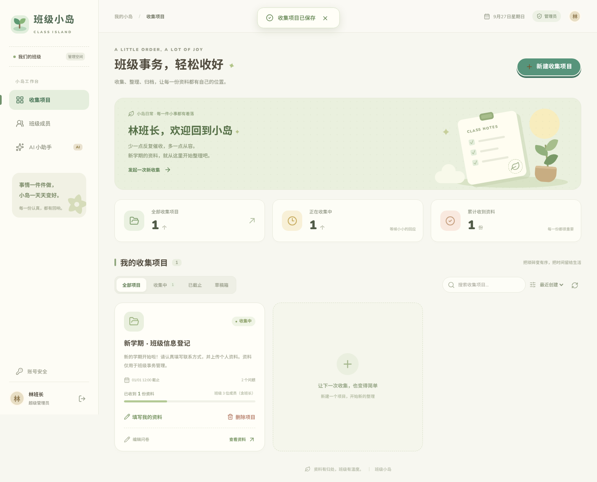

# 班级小岛 🌿

一个给大学班长使用的班级资料收集系统。后端 **FastAPI**，前端 **React + TypeScript + animal-island-ui 2.x**，奶油色 / 鼠尾草绿的岛屿风格，支持手机填写。

## 界面预览



[查看手机端截图](docs/screenshots/mobile.png)。截图使用自动化测试中的虚构数据，正式数据库不会预装示例成员。

## 第一版范围

- **单班级**：超级管理员管理全部成员及项目，不是多租户系统。
- **注册审核**：同学填写用户名、姓名、学号和密码；管理员批准后才能登录。管理员可以拒绝、停用账号、重置密码；看不到原密码。
- **项目问卷**：标题、说明、草稿 / 发布、截止时间；支持简答、长文本、数字、日期、单选、附件，各题可以设置必填或选填、补充说明、调整顺序。
- **填写及修改**：一人每个项目一份提交，**班长也有「填写我的资料 / 修改我的资料」入口**，待填写名单与成员统计包含班长。学生只能查看自己的资料，截止前可修改。截止后禁止学生上传、提交、修改和撤回；管理员不受截止限制，可以填写自己、代填、修正、延长或清除截止时间。
- **删除及撤回**：管理员可永久删除项目和全体填写记录、附件；用户可在截止前撤回自己的填写（管理员可随时撤回自己或他人的填写）。撤回删除该用户在本项目上传的全部附件，之后可以重新填写。均有确认提示，操作不可恢复，请先备份。
- **附件**：图片、PDF、Word、Excel、PPT、TXT、CSV、ZIP；每个文件最多 20 MB、每题最多 10 个、每人每项目累计上传最多 200 MB。所有下载经过身份及权限校验，不公开存储目录。
- **汇总及离线导出**：Excel 风格表格、搜索、待填写名单及管理员编辑；支持 **Excel 图片预览 + 原文件 OLE 嵌入**，以及 **Excel + 全部原文件 ZIP** 两种导出。不再依赖服务器下载 URL。
- **AI 侧栏入口**：配置 OpenAI 兼容 Base URL、模型、API Key，并进入聊天。密钥只在后端加密保存。**本版不读取、整理、重命名或操作学生文件，也不自动发送学生资料给 AI**。
- **账号安全**：个人修改密码；修改 / 重置密码使旧会话全部失效。关键管理操作写入数据库审计表。

> 已有提交的问卷不允许删除旧问题、更换题型或删除已有选项，避免丢失历史资料；可新增问题、改说明、调整顺序及必填状态。新增必填题可能让已有提交需要补填，系统不自动伪造答案。不同收集需求建议新建项目。

## 本地运行

需要 Python 3.12+、Node.js 22+。下面在仓库根目录执行（Linux / macOS）：

### 1. 安装后端并创建超级管理员

```bash
python3 -m venv .venv
.venv/bin/pip install -r backend/requirements.lock.txt
.venv/bin/python backend/app.py create-admin --username admin --name 班长
```

命令会提示输入至少 8 位的密码。**没有默认管理员和默认密码，也不会将首个注册用户自动提升为管理员。** 已存在的用户名不会被覆盖。可以使用同一命令、不同用户名创建额外的超级管理员。

Windows 对应命令为 `.venv\Scripts\python.exe` / `.venv\Scripts\pip.exe`。

### 2. 启动后端

```bash
.venv/bin/uvicorn app:app --app-dir backend --host 127.0.0.1 --port 8000 --reload
```

### 3. 启动前端（新终端）

```bash
cd frontend
npm ci
npm run dev
```

浏览器打开 **http://localhost:5173**。前端将 `/api` 代理到后端，无需跨域配置。

开发环境不要直接把后端端口暴露到公网。Vite 用于开发，不是生产服务器。前端的 `npm run preview` 只预览静态产物，不包含 API 代理；完整应用请用上述开发方式或 Docker。

后端接口文档：本地 **http://127.0.0.1:8000/docs**。所有写请求还需要 `X-Requested-With: class-island` 请求头；Swagger 自带的 Try it out 默认不添加该头，建议使用前端或带此头的 API 客户端测试。

## 启动、停止、重启脚本

需先安装 Docker Engine 和 Docker Compose v2（支持 `up --wait`）。Linux / macOS / WSL 在项目目录执行：

```bash
./start.sh     # 构建并启动；等待后端健康检查通过
./stop.sh      # 停止服务；保留容器、数据库和附件
./restart.sh   # 先构建，再停止和重新启动，使代码及 .env 修改生效
```

脚本可以从任意工作目录调用，例如 `/root/banjiguanli/start.sh`。第一次启动自动将 `.env.example` 复制为 `.env`（权限 600），不会覆盖已有配置。默认访问 **http://localhost:8080**，自定义域名和端口请修改 `.env`。

重启会短暂停机；预构建失败则不停止原有服务。脚本不执行 `down -v`，不会清空数据。启动失败时会以非零状态退出，可在项目目录执行 `docker compose logs --tail=100` 排查。首次启动后仍需手动创建管理员，命令见下方。

脚本自动化测试（模拟 Docker，不改动实际容器）：

```bash
python3 -m unittest discover -s tests -v
```

## Docker Compose

```bash
cp .env.example .env
# 按实际访问地址修改 .env 中的 APP_ORIGIN
# 默认仅监听本机 http://localhost:8080

docker compose up -d --build
docker compose exec backend python app.py create-admin --username admin --name 班长
```

打开 **http://localhost:8080**，用刚刚创建的账号登录。

- `.env` 被 Docker Compose 自动读取，**本地直接运行 Python 不会自动加载 `.env`**，需在启动终端设置环境变量。
- `APP_ORIGIN` 必须与浏览器地址的协议、域名及端口一致，不含路径，例如 `https://class.example.com`。否则写请求会被 CSRF 检查拒绝。
- 对真实学生开放前，在前端服务之前配置 **HTTPS 反向代理**，设置 `APP_ORIGIN=https://你的域名`、`COOKIE_SECURE=true`。本地 HTTP 测试才使用 `false`。
- 默认绑定 `127.0.0.1:8080`，可由宿主机 Caddy / Nginx 反向代理。只有明确了解网络风险时再修改 `HTTP_BIND`。
- 后端不发布宿主机端口；仅由前端 Nginx 访问。容器后端信任代理 IP 头，**不要单独将后端 8000 端口公开**。Nginx 会覆盖用户传入的转发 IP。
- Nginx 单请求最大 21 MB，后端单文件限制 20 MB。前端逐个上传附件。AI 请求代理超时 75 秒，后端上游超时 60 秒。
- 数据保存在 `island-data` 命名卷。不要执行 `docker compose down -v`，它会删除资料。

## 使用流程

1. 管理员新建收集项目，添加问题，设置必填和截止时间，勾选「发布给同学们」。
2. 同学自行注册，班长在「班级成员」核实姓名和学号后通过审核。
3. 同学登录后填写问卷、上传附件，点击「提交资料」。**只上传附件而不提交，不算完成填写。**
4. 班长进入「查看资料」查看全班结果，可切换待填写名单、修改某人的答案、导出 Excel。
5. 需要补交时，编辑项目延长截止时间；学生刷新后即可重新修改。
6. AI 功能在管理员侧栏「AI 小助手 → 模型配置」。未配置密钥时不产生外部 AI 请求。

截止时间以浏览器本地时区输入和显示，后端统一保存为 UTC，最终由后端时间判定是否允许提交。服务器时钟应保持同步。Excel 的更新时间使用 UTC。

## Excel 与 ZIP 附件导出

在项目的「查看资料」中选择：

- **导出 Excel**：`填写结果` 保留所有答案及原文件名，点击附件字段可跳到 `附件` 表。该表直接展示图片缩略图，每个原文件都有 OLE 附件图标，双击可尝试打开。图片的原始字节也另外完整嵌入，不只是缩略图。PDF、Word、PPT 等均嵌入真实文件，而不是 URL。
- **下载资料包 ZIP**：包含 `workbook.xlsx`、`attachments/` 全部原文件、`manifest.json`（文件名、填写人、路径及 SHA-256）和使用说明。**先完整解压**，再打开 Excel；Excel 中使用相对路径指向原文件，无需连接本系统。软件阻止链接时可以直接浏览附件目录。

### 兼容性与限制

1. OLE 适用于支持此能力的 **Windows 桌面 Excel**，还需要相应文件阅读软件；网页 Excel、Mac Excel、WPS 和手机端支持可能不同。Office 安全策略可能阻止附件打开，**不要为此关闭安全保护**；可改用 ZIP。
2. 当前环境没有 Windows 桌面 Excel，已验证 OOXML 关系、图片读取、OLE 容器和附件逐字节提取，但**没有宣称完成真实桌面 Excel / WPS 的双击打开验证**。首次使用请先拿测试资料验证你所在电脑的 Office 版本。
3. Excel 内部附件使用编号英文名，避免系统编码问题；原始中文文件名仍显示在附件表。ZIP 使用唯一 ID + 安全文件名，不覆盖同名文件，也不写出越界路径。
4. 图片缩略图最长 220×150，动图仅预览首帧；超过 2000 万像素或损坏图片不生成预览，仍保留原文件，并标记说明。文件本身不做内容解析或杀毒。
5. 只导出已提交且答案中仍引用的附件。未提交上传不导出；附件记录或磁盘文件缺失时明确报错，**不静默生成残缺备份**。
6. 单次导出最多 **100 MB 原始附件、500 个文件**，避免耗尽小服务器内存；超限时拒绝导出，可拆分收集项目或联系管理员。大规模需求建议后续增加后台分批打包。
7. Excel 和 ZIP 都包含实际个人资料，离开系统后不再受账号权限保护，请安全保管。不要用不支持 OLE 的软件重新保存唯一的嵌入版备份，以免丢失对象。

升级前建议备份数据，执行 `./restart.sh` 重新构建；本次新增附件清理队列表由启动时自动创建，不删除现有资料。

## AI 配置和隐私

- Base URL 通常形如 `https://api.openai.com/v1`，不要附带 `/chat/completions`；也支持其他兼容服务。
- 只允许公网 HTTPS、443 端口；拒绝私网、回环及保留地址；请求使用已校验的 IP 并保留原域名的 TLS SNI / 证书验证，避免 DNS 重绑定；不跟随重定向、不继承宿主代理环境变量。
- 密钥输入留空表示保留旧密钥；可勾选清除。后端通过 Fernet 加密后写入 SQLite，浏览器只能获知是否已配置，不能读取原密钥。
- 仅发送本次聊天文字。最近最多 29 条消息，单条最多 12000 字符，总请求最多 60000 字符；上下文过长时请清空聊天。
- 当前聊天只在页面内存中，离开 AI 页面或刷新会丢失；没有自动保存聊天，也没有工具调用、文件操作或 shell 执行能力。
- 手动输入的内容会传给所配置的服务商，避免粘贴学生敏感信息；AI 内容必须人工核实。
- 自动测试使用模拟 AI 服务验证协议和密钥处理，真实服务的可用性、额度、计费需在配置后自行确认。

## 数据与安全

本地数据目录为 `backend/data/`，可用 `DATA_DIR` 指定绝对路径。包含：

```text
island.db        # 用户、问卷、提交、会话、配置及审计记录
secret.key       # AI 密钥加密主密钥，权限 0600
uploads/        # 随机 ID 命名的附件，原文件名保存在数据库
```

- **数据库、secret.key、uploads 必须一起备份**。丢失主密钥后无法解密已有 AI API Key，只能重新配置。
- 本地备份先停止后端，再完整复制数据目录。Docker 备份示例：

  ```bash
  docker compose stop backend
  docker compose cp backend:/app/data ./island-backup-$(date +%Y%m%d-%H%M%S)
  docker compose start backend
  ```

  备份应加密、限制访问，并定期验证恢复。恢复时先停服务，保留全部文件；容器目录所有者为 UID 10001。
- 密码使用随机盐 + scrypt；会话 Cookie 使用 HttpOnly、SameSite=Lax，有效期 7 天，服务端只保存令牌哈希。
- 写请求校验 Origin 及自定义请求头，不开启通配 CORS；前端生产 Nginx 配置 CSP、禁止被 iframe 嵌入和 MIME 嗅探。
- 登录、注册、AI 请求有按 IP 的 15 分钟限流（分别 60 / 15 / 40 次），共享校园出口可能触发限流，可稍后重试。生产可结合网关验证码和更细粒度限流。
- Excel 中所有用户输入强制按文本输出，避免公式注入；附件以下载方式返回，不以内联 HTML 执行。
- 附件按扩展名白名单校验，**不包含杀毒、内容真实性检测、OCR 或文档解析**。下载者仍应谨慎打开文件，公开部署建议增加恶意文件扫描。
- 移除表单里的单个附件仅取消答案关联，未提交上传仍计入配额；**撤回整份填写会清理该人在该项目的全部上传，删除项目会清理该项目全部上传**。先事务性删除记录并写入清理队列，再删除磁盘文件；文件删除失败留待下次启动重试，记录撤销后旧下载地址立即不可用。没有回收站，请先备份。
- 第一版没有邮件验证、自动密码找回、多班级隔离、并发编辑冲突提示、通用数据库版本迁移工具。项目可转回草稿暂停开放，或者经确认后永久删除。
- SQLite 适合一个班级的小规模使用；大量并发 / 多班级时应迁移到 PostgreSQL 和对象存储，并增加分页与后台任务。

## 验证

```bash
# 后端集成测试（临时数据库，不接触真实资料）
.venv/bin/python -m pytest backend -q

# 前端类型检查与生产构建
cd frontend
npm run build

# 浏览器端到端测试
npx playwright install chromium
npm run test:e2e
```

端到端测试自动启动 **一次性的临时数据库后端**（8019 端口）和 Vite（5179 端口），不读取或修改 `backend/data`。测试中的固定账号仅存在于临时测试服务器。Linux 需要安装 Chromium 系统依赖时可运行 `npx playwright install --with-deps chromium`。

覆盖：注册等待审核、审核通过、项目发布、手机表单填写、附件上传、修改提交、表格查看、Excel 下载、截止禁改、管理员越过截止编辑、延期后重新开放、AI 配置入口、移动端无横向溢出。截图保存在 `frontend/test-results/`。

后端测试额外覆盖越权访问、跨用户附件引用、草稿可见性、密码修改后会话撤销、CSRF、文件大小限制、Excel 公式注入及 AI 配置加密与协议调用。新增测试覆盖班长自己的提交、撤回时限与附件清理、项目删除隔离、离线包关系与 SHA-256 核对、图片内嵌、同名文件、损坏图片、缺失附件和导出上限。OLE 由独立读取器检查，包括 8 MB / 20 MB 大文件的 DIFAT 无损往返；浏览器测试覆盖两种实际下载及删除 / 撤回确认。

Python 类型检查可运行 `pyright -p pyrightconfig.json`；默认寻找根目录 `.venv`。编辑器环境与 Python 版本不一致时需调整解释器配置。

## 目录

```text
backend/app.py                FastAPI 接口、SQLite 存储及管理员初始化命令
backend/exports.py            图片预览、嵌入版 Excel 及 ZIP 离线导出
backend/ole_package.py        OLE Package / Compound File 容器写入
backend/test_*.py             后端权限、生命周期及离线导出测试
backend/e2e_server.py         仅供端到端测试的临时服务器
backend/requirements.lock.txt 已验证依赖版本
frontend/src/                React 页面、组件、请求封装及主题
frontend/tests/              浏览器流程测试
frontend/nginx.conf          生产静态服务与 API 代理
frontend/package-lock.json   前端依赖锁文件
docker-compose.yml           单机容器部署
```

UI 使用 MIT 协议的 [animal-island-ui](https://github.com/guokaigdg/animal-island-ui)，详见 [THIRD_PARTY_NOTICES.md](./THIRD_PARTY_NOTICES.md)。
